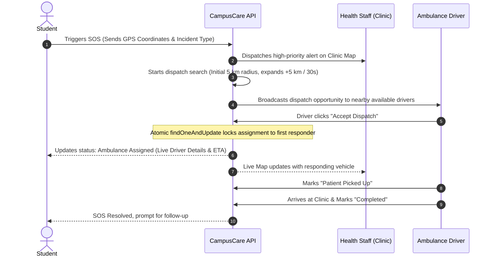
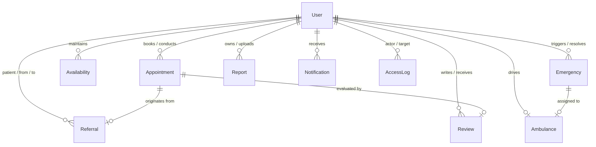

# 🏥 CampusCare — Integrated Campus Health & Emergency Dispatch System

> A comprehensive, real-time healthcare management and emergency response platform designed specifically for university campuses.

[](https://nextjs.org/)
[](https://reactjs.org/)
[](https://www.mongodb.com/)
[](https://tailwindcss.com/)
[](https://next-auth.js.org/)
[](https://recharts.org/)
[](https://leafletjs.com/)

🔗 **Live Demo:** [https://YOUR-VERCEL-URL.vercel.app](https://YOUR-VERCEL-URL.vercel.app)  
*(Use seeded demo accounts from the table below to explore different roles)*

---

## 📖 About the Project

### The Problem
University campus health centres frequently struggle with fragmented medical records, long queues during walk-ins, lack of appointment visibility, and inefficient emergency coordination. During critical emergencies or accidents on campus, delays in locating the student and coordinating responder ambulances can cost crucial minutes.

### The Solution
**CampusCare** unifies everyday outpatient care and rapid emergency response into a single, cohesive portal. It equips students with instant appointment booking, digital health record access, and one-tap GPS-enabled SOS broadcasting. Concurrently, it empowers healthcare staff with doctor calendars, referral management, and an atomic emergency ambulance dispatch system with dynamic radius expansion.

---

## 📸 Screenshots

| Landing Page | Student Booking & Calendar |
| :---: | :---: |
|  |  |
| **Medical Reports & History** | **Doctor / Staff Dashboard** |
|  |  |
| **Emergency SOS & Live Map** | **Ambulance Dispatch Dashboard** |
|  |  |
| **Admin Analytics & Insights** | **Theme System (Dark Mode)** |
|  |  |

---

## ✨ Key Features by Role

| Role | Key Capabilities |
| :--- | :--- |
| 🎓 **Student** | • Role-based authenticated portal with personal health history.<br>• Search doctors by department/service and book appointments based on real-time availability.<br>• Secure diagnostic report viewer with download and upload capabilities.<br>• Submit post-consultation 1–5 star ratings and reviews (with anonymous option).<br>• One-tap Emergency SOS with auto-captured GPS coordinates and live incident status tracking.<br>• Real-time in-app notification center for appointment status, reports, and referrals. |
| 🩺 **Health Staff (Doctor)** | • Comprehensive clinical dashboard with today's appointments and queue management.<br>• Set working hours and configure custom availability slots.<br>• Record clinical visit notes, prescribe follow-ups, and mark visits as completed.<br>• Patient record lookup with full compliance access auditing.<br>• Inter-clinician referrals (routine, urgent, emergency) and bulk emergency-leave patient transfer.<br>• Real-time emergency alerts with interactive Leaflet map and response timer. |
| 🚑 **Ambulance Driver** | • Dedicated driver dashboard with toggleable duty status (`available`, `busy`, `offline`).<br>• Live GPS location streaming.<br>• Atomic dispatch claim: first available driver to accept locks the pickup with concurrency protection.<br>• Progressive multi-stage dispatch workflow (`accepted` ➔ `picked-up` ➔ `completed`).<br>• Integrated navigation assistance and caller/student direct contact links. |
| 🛡️ **Administrator** | • Interactive analytics dashboard powered by Recharts (appointment trends, department volume, emergency response times, doctor ratings).<br>• User management: create verified health staff and ambulance driver accounts.<br>• Campus-wide emergency incident monitoring and resolution oversight.<br>• HIPAA/FERPA-aligned patient record access audit logs tracking clinical record lookups and report downloads. |

---

## 🛠️ Tech Stack

| Layer | Technology | Details |
| :--- | :--- | :--- |
| **Frontend** | Next.js 14 (App Router), React 18 | Server & Client components, modern layout architecture |
| **Styling** | Tailwind CSS, Lucide React, next-themes | Semantic design system with full Light & Dark mode support |
| **Backend** | Next.js Route Handlers (Node.js runtime) | RESTful API endpoints, server-side authentication & role validation |
| **Database** | MongoDB & Mongoose ODM | Relational schema modeling, atomic updates, indexes |
| **Authentication** | NextAuth.js (v4) | Credentials provider, JWT session strategy, bcrypt hashing |
| **Maps & Location** | Leaflet, React-Leaflet, OpenStreetMap | Interactive emergency mapping, GPS marker tracking, distance estimation |
| **Data Visualization** | Recharts | Responsive line, bar, area, and pie charts for admin analytics |
| **Deployment** | Vercel & MongoDB Atlas | Cloud-native deployment ready with zero external server dependencies |

---

## 🔄 How It Works

### Emergency SOS & Ambulance Dispatch Flow



### Database Architecture



---

## 📁 Project Structure

```
campushealth/
├── app/                          # Next.js App Router structure
│   ├── (auth)/                   # Authentication pages (login, register)
│   ├── admin/                    # Admin portal (analytics, user management, audit logs)
│   ├── ambulance/                # Ambulance driver dashboard & active ride console
│   ├── api/                      # REST API endpoints (appointments, emergencies, reports, etc.)
│   ├── appointments/             # Appointment management views
│   ├── doctor/ & staff/          # Clinician workspaces, queues, and referral manager
│   ├── emergency/                # Student emergency SOS trigger and tracking page
│   ├── reports/                  # Medical records and diagnostic upload center
│   ├── layout.js                 # Global layout with ThemeProvider and SessionProvider
│   └── page.js                   # Public landing page with service overview
├── components/                   # Reusable UI components (Navbar, Modals, LeafletMap, Charts)
├── lib/                          # Core business logic and server utilities
│   ├── auth.js                   # NextAuth credentials configuration and role callbacks
│   ├── db.js                     # Cached Mongoose connection handler
│   ├── dispatch.js               # Haversine distance and expanding radius ambulance search
│   └── notify.js                 # Unified in-app notification dispatcher
├── models/                       # Mongoose schemas (User, Emergency, Ambulance, Referral, etc.)
├── scripts/                      # Operational and database seeding scripts
└── public/                       # Static assets and icons
```

---

## 🚀 Getting Started

### Prerequisites
- [Node.js](https://nodejs.org/) (v18.17.0 or higher recommended)
- [MongoDB](https://www.mongodb.com/) (Local instance or MongoDB Atlas cluster connection string)
- Git

### 1. Clone & Install

```bash
git clone https://github.com/ashwaniipandey/campushealth.git
cd campushealth
npm install
```

### 2. Configure Environment Variables

Create a `.env.local` file in the root directory:

```env
# Database Connection
MONGODB_URI=mongodb+srv://<username>:<password>@cluster0.example.mongodb.net/campuscare?retryWrites=true&w=majority

# NextAuth Configuration
NEXTAUTH_URL=http://localhost:3000
NEXTAUTH_SECRET=your_generated_nextauth_secret

# Initial Admin Account (used by seed:admin)
ADMIN_NAME="System Administrator"
ADMIN_EMAIL=admin@campuscare.edu
ADMIN_PASSWORD=your_strong_admin_password
```

> **Tip:** You can generate a cryptographically secure `NEXTAUTH_SECRET` by running:
> ```bash
> openssl rand -base64 32
> ```

### 3. Run Development Server

```bash
npm run dev
```

Open [http://localhost:3000](http://localhost:3000) in your browser to view the application.

---

## 📜 Useful Scripts

| Command | Description |
| :--- | :--- |
| `npm run dev` | Starts the Next.js development server with hot module reloading on port 3000. |
| `npm run build` | Compiles the production build and validates all TypeScript/JSX dependencies. |
| `npm run start` | Starts the optimized production server. |
| `npm run seed:admin` | Initializes the first system administrator account using variables from `.env.local`. |
| `npm run seed:demo` | Seeds full mock data: students, doctors, ambulances, appointments, and active emergencies. |
| `npm run clear:demo` | Safely removes all mock accounts and demo documents tagged with `isDemo: true`. |
| `npm run test:referral` | Verifies doctor-to-doctor patient referral workflows and notification triggers. |

---

## 👥 Demo Accounts

If you populate the database using `npm run seed:demo`, you can test all four role experiences using the pre-seeded credentials:

| Role | Email | Password |
| :--- | :--- | :--- |
| 🎓 **Student** | `student1@demo.edu` | `Demo@12345` |
| 🩺 **Doctor / Staff** | `staff1@demo.edu` | `Demo@12345` |
| 🚑 **Ambulance Driver** | `ambulance1@demo.edu` | `Demo@12345` |
| 🛡️ **Administrator** | *(Configured in your `.env.local` via `seed:admin`)* | *(Configured in `.env.local`)* |

---

## 🔒 Security & Privacy

- **Password Encryption:** Passwords are salted and hashed using `bcryptjs` before storage.
- **Strict Role-Based Routing:** Edge middleware and route handlers enforce granular authorization (`student`, `staff`, `ambulance`, `admin`).
- **Input Sanitization & Projection:** Critical endpoints strip out sensitive fields such as passwords and internal tokens from JSON responses.
- **Atomic Operations:** Concurrency-safe dispatch assignment prevents double-booking of ambulances during simultaneous claims.
- **Audit Logging:** Every clinician lookup, report view, and diagnostic record download is recorded in `AccessLog` for regulatory compliance.
- **File Upload Safeguards:** Medical reports are validated for allowed MIME types (PDF, PNG, JPEG) and enforced with strict size limits.

---

## ⚠️ Academic Disclaimer & Emergency Notice

> **IMPORTANT DISCLAIMER**  
> CampusCare is an educational and portfolio demonstration system created to illustrate full-stack architecture, real-time dispatch systems, and role-based healthcare workflows. It is **not** an FDA-cleared, HIPAA-certified, or accredited medical dispatch appliance.
> 
> 🚨 **In the event of a genuine life-threatening medical emergency, immediately dial your local emergency services (112 in India, 911 in the USA, or your regional emergency helpline) or contact your campus security office directly.**

---

## 🔮 Future Improvements

- [ ] **Automated Communication:** Integration of Twilio SMS or WhatsApp alerts for emergency broadcasts.
- [ ] **Real-Time WebSockets:** Transition from polling to WebSocket/SSE channels for sub-second map marker synchronization.
- [ ] **Offline-First PWA:** Progressive Web App capabilities for cached health card view during connectivity drops.
- [ ] **Automated Testing Suite:** End-to-end integration tests using Cypress or Playwright.
- [ ] **Telemedicine Integration:** WebRTC-based video consultations directly inside the appointment console.

---

## 👨‍💻 Author

Developed with care by **Ashwani Pandey**

- **GitHub:** [@ashwaniipandey](https://github.com/ashwaniipandey)
- **LinkedIn:** [Ashwani Pandey](https://linkedin.com/in/)
- **Repository:** [https://github.com/ashwaniipandey/campushealth](https://github.com/ashwaniipandey/campushealth)

*Built to make campus healthcare accessible, fast, and reliable for everyone.*
