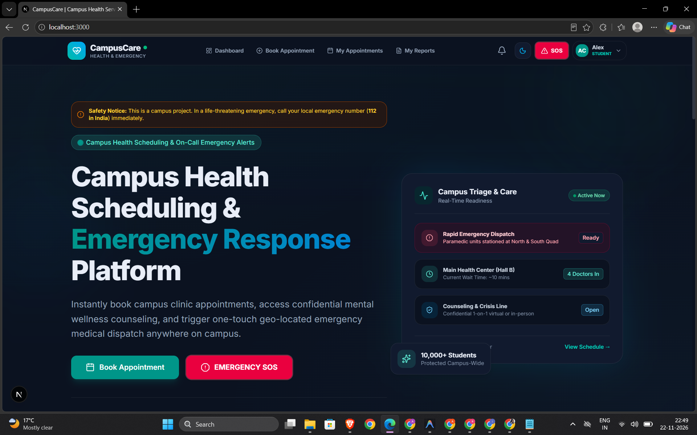
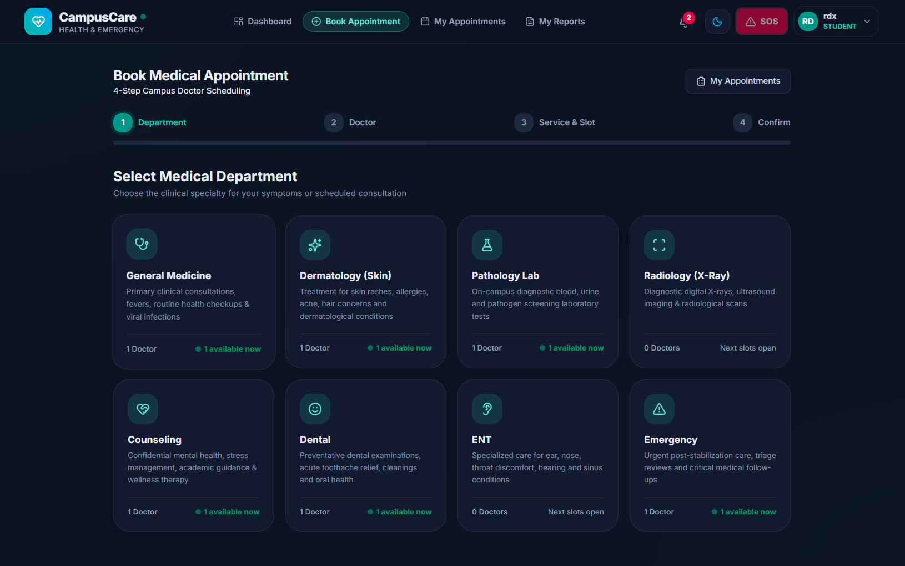
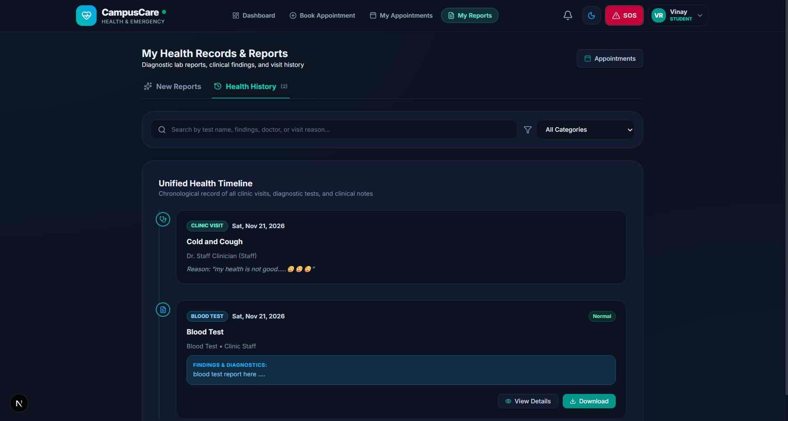
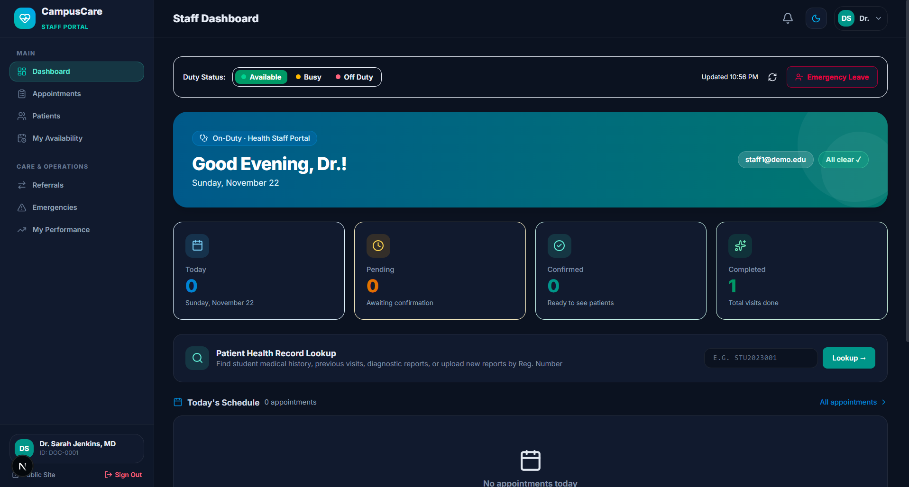
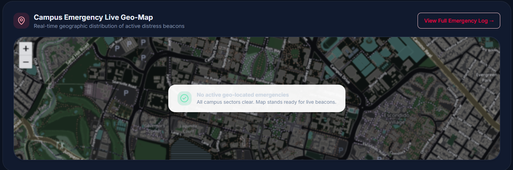
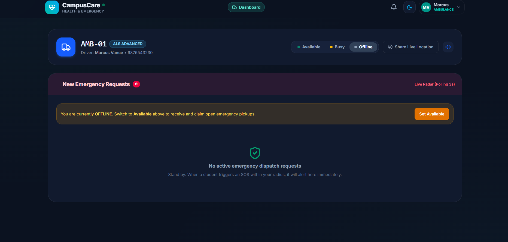
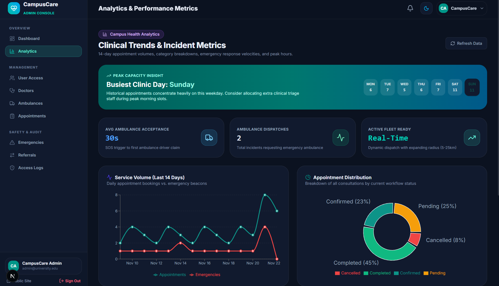
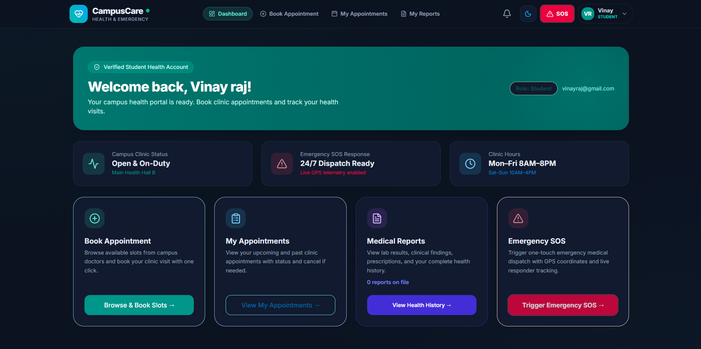
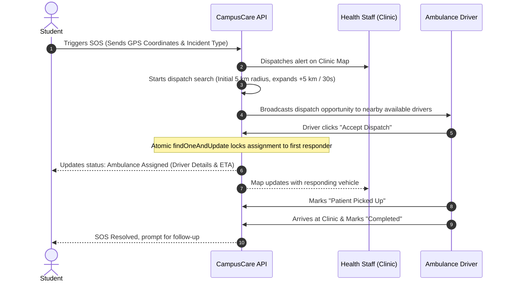
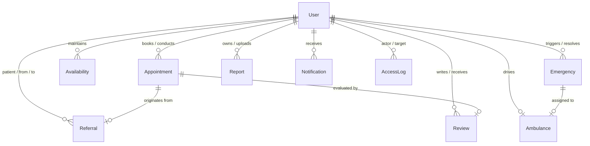

# 🏥 CampusCare — Integrated Campus Health & Emergency Dispatch System

> A comprehensive, near real-time (polling every 3 to 15 seconds) healthcare management and emergency response platform designed specifically for university campuses.

[](https://nextjs.org/)
[](https://reactjs.org/)
[](https://www.mongodb.com/)
[](https://tailwindcss.com/)
[](https://next-auth.js.org/)
[](https://recharts.org/)
[](https://leafletjs.com/)

🔗 **Live Demo:** [https://campusscare.vercel.app](https://campusscare.vercel.app)  
*(On the live site, please sign up as a Student or Health Staff to explore. Demo accounts (`student1@demo.edu`, `staff1@demo.edu`, `ambulance1@demo.edu` with password `Demo@12345`) work only after running `npm run seed:demo` locally. Ambulance driver accounts are created by the admin.)*

---

## 📖 About the Project

### The Problem
University campus health centres frequently struggle with fragmented medical records, long queues during walk-ins, lack of appointment visibility, and inefficient emergency coordination. During critical emergencies or accidents on campus, delays in locating the student and coordinating responder ambulances can cost crucial minutes.

### The Solution
**CampusCare** unifies everyday outpatient care and rapid emergency response into a single, cohesive portal. It equips students with instant appointment booking, digital health record access, and one-tap GPS-enabled SOS broadcasting. Concurrently, it empowers healthcare staff with doctor calendars, referral management, and an atomic emergency ambulance dispatch system with dynamic radius expansion.

---

## 📸 Screenshots

| Landing Page | Student Booking & Calendar |
| :---: | :---: |
|  |  |
| **Medical Reports & History** | **Doctor / Staff Dashboard** |
|  |  |
| **Emergency SOS & Live Map** | **Ambulance Dispatch Dashboard** |
|  |  |
| **Admin Analytics & Insights** | **Theme System (Dark Mode)** |
|  |  |

---

## ✨ Key Features by Role

| Role | Key Capabilities |
| :--- | :--- |
| 🎓 **Student** | • Browse departments and pick a doctor with live availability.<br>• Book and cancel appointments.<br>• View and download medical reports uploaded by staff (students do not upload).<br>• Personal health history timeline and profile management.<br>• Submit post-consultation 1–5 star ratings and reviews (with anonymous option).<br>• One-tap Emergency SOS with auto-captured GPS coordinates and incident status tracking. SOS is available only to students; logged-out visitors see a "log in as a student" message with Dial 112 still usable. The emergency modal includes a "Campus Security" call button that shows only if `NEXT_PUBLIC_CAMPUS_SECURITY_PHONE` is set.<br>• Near real-time (polling every 3 to 15 seconds) in-app notifications for appointment status, reports, and referrals. |
| 🩺 **Health Staff (Doctor)** | • Configure custom availability slots.<br>• Manage appointments: confirm or complete visits with clinical visit notes.<br>• Patient lookup by student registration number.<br>• Upload medical reports.<br>• Inter-clinician referrals and emergency-leave patient transfer.<br>• Doctor performance dashboard and toggleable duty status.<br>• Direct access to "Active Emergencies" (/staff/emergencies) with interactive map and response timer (role link shown instead of SOS button). |
| 🚑 **Ambulance Driver** | • Dedicated driver dashboard with toggleable duty status (`available`, `busy`, `offline`) and "Ambulance Console" (/ambulance/dashboard) role link shown instead of SOS button.<br>• Live GPS location streaming.<br>• Atomic dispatch claim: first available driver to accept locks the pickup with concurrency protection.<br>• Progressive multi-stage dispatch workflow (`accepted` ➔ `picked-up` ➔ `completed`).<br>• Integrated navigation assistance and caller/student direct contact links. |
| 🛡️ **Administrator** | • Analytics dashboard powered by Recharts (appointment trends, department volume, emergency response times, doctor ratings).<br>• User management (admin creates ambulance driver accounts; staff and students sign up themselves).<br>• Oversight of appointments, "Emergencies" (/admin/emergencies role link shown instead of SOS button), ambulances, and referrals.<br>• Access logs providing an audit trail of who looked up or downloaded which student record. |

---

## 🛠️ Tech Stack

| Layer | Technology | Details |
| :--- | :--- | :--- |
| **Frontend** | Next.js 16 (App Router), React 19 | Server & Client components, modern layout architecture |
| **Styling** | Tailwind CSS 4, Lucide React, next-themes | Semantic design system with full Light & Dark mode support; custom brand heart logo favicon (app/icon.svg) |
| **Backend** | Next.js Route Handlers (Node.js runtime) | RESTful API endpoints, server-side authentication & role validation |
| **Database** | MongoDB & Mongoose ODM | Document modeling with references, atomic updates and indexes |
| **Authentication** | NextAuth.js (v4) | Credentials provider, JWT session strategy, bcrypt hashing |
| **Maps & Location** | Leaflet, React-Leaflet, OpenStreetMap | Interactive emergency mapping, GPS marker tracking, distance estimation |
| **Data Visualization** | Recharts | Responsive line, bar, area, and pie charts for admin analytics |
| **Deployment** | Vercel & MongoDB Atlas | Cloud-native deployment ready with zero external server dependencies |

---

## 🔄 How It Works

### Emergency SOS & Ambulance Dispatch Flow



### Database Architecture



---

## 📁 Project Structure

```
campuscare/
├── app/                          # Next.js App Router
│   ├── admin/                    # Admin dashboard, analytics, users, and audit logs
│   ├── ambulance/                # Ambulance driver dashboard and dispatch console
│   ├── api/                      # REST API route handlers
│   ├── icon.svg                  # Brand favicon icon (heart pulse logo)
│   ├── login/                    # Login page
│   ├── profile/                  # User profile management
│   ├── signup/                   # Registration page (students and health staff)
│   ├── staff/                    # Doctor & clinical staff portal, queue, and referrals
│   ├── student/                  # Student portal (appointments, reports, SOS)
│   ├── globals.css               # Global styles and design system variables
│   ├── layout.js                 # Root layout with providers and navigation
│   └── page.js                   # Landing page
├── components/                   # Reusable UI components (Navbar, Modals, Map, Charts)
├── lib/                          # Core utilities and helpers
│   ├── auth.js                   # NextAuth credentials configuration and callbacks
│   ├── dispatch.js               # Haversine distance and expanding radius dispatch logic
│   ├── mongodb.js                # Cached MongoDB connection handler
│   └── notify.js                 # In-app notification dispatcher
├── models/                       # Mongoose schemas (User, Appointment, Emergency, etc.)
├── public/                       # Static public assets
├── scripts/                      # Database seed and maintenance scripts
└── middleware.js                 # Edge authentication and role-based route protection
```

---

## 🚀 Getting Started

### Prerequisites
- [Node.js](https://nodejs.org/) (v18.17.0 or higher recommended)
- [MongoDB](https://www.mongodb.com/) (Local instance or MongoDB Atlas cluster connection string)
- Git

### 1. Clone & Install

```bash
git clone https://github.com/ashwaniipandey/campuscare.git
cd campuscare
npm install
```

### 2. Configure Environment Variables

Create a `.env.local` file in the root directory:

```env
# Database Connection
MONGODB_URI=mongodb+srv://<username>:<password>@cluster0.example.mongodb.net/campus-health?retryWrites=true&w=majority

# NextAuth Configuration
NEXTAUTH_URL=http://localhost:3000
NEXTAUTH_SECRET=your_generated_nextauth_secret

# Initial Admin Account (used by seed:admin)
ADMIN_NAME="System Administrator"
ADMIN_EMAIL=admin@campuscare.edu
ADMIN_PASSWORD=your_strong_admin_password

# Campus Security Dial (OPTIONAL - displays Campus Security button in SOS modal if set)
NEXT_PUBLIC_CAMPUS_SECURITY_PHONE=
```

> **Tip:** You can generate a cryptographically secure `NEXTAUTH_SECRET` by running:
> ```bash
> openssl rand -base64 32
> ```

### 3. Run Development Server

```bash
npm run dev
```

Open [http://localhost:3000](http://localhost:3000) in your browser to view the application.

---

## 📜 Useful Scripts

| Command | Description |
| :--- | :--- |
| `npm run dev` | Starts the Next.js development server with hot module reloading on port 3000. |
| `npm run build` | Creates the production build. |
| `npm run start` | Starts the optimized production server. |
| `npm run seed:admin` | Initializes the first system administrator account using variables from `.env.local`. |
| `npm run seed:demo` | Seeds full mock data: students, doctors, ambulances, appointments, and active emergencies. |
| `npm run clear:demo` | Safely removes all mock accounts and demo documents tagged with `isDemo: true`. |
| `npm run test:referral` | Verifies doctor-to-doctor patient referral workflows and notification triggers. |

---

## 👥 Demo Accounts

On the live deployment, users should sign up as a Student or Health Staff. Demo accounts (`student1@demo.edu`, `staff1@demo.edu`, `ambulance1@demo.edu`, password `Demo@12345`) work only after running `npm run seed:demo` locally. Ambulance driver accounts are created by the admin.

| Role | Email | Password |
| :--- | :--- | :--- |
| 🎓 **Student** | `student1@demo.edu` | `Demo@12345` |
| 🩺 **Doctor / Staff** | `staff1@demo.edu` | `Demo@12345` |
| 🚑 **Ambulance Driver** | `ambulance1@demo.edu` | `Demo@12345` |
| 🛡️ **Administrator** | *(Configured in your `.env.local` via `seed:admin`)* | *(Configured in `.env.local`)* |

---

## 🔒 Security & Privacy

- **Password Encryption:** Passwords are salted and hashed using `bcryptjs` before storage.
- **Strict Role-Based Routing:** Edge middleware and route handlers enforce granular authorization (`student`, `staff`, `ambulance`, `admin`).
- **Input validation & Projection:** Critical endpoints strip out sensitive fields such as passwords and internal tokens from JSON responses.
- **Atomic Operations:** Concurrency-safe dispatch assignment prevents double-booking of ambulances during simultaneous claims.
- **Audit Logging:** Maintains an audit trail of who looked up or downloaded which student record.
- **File Upload Safeguards:** Medical reports are validated for allowed MIME types (PDF, PNG, JPEG) and enforced with strict size limits.

---

## ⚠️ Academic Disclaimer & Emergency Notice

> **IMPORTANT DISCLAIMER**  
> CampusCare is an educational and portfolio demonstration system created to illustrate full-stack architecture, dispatch systems, and role-based healthcare workflows. It is **not** an FDA-cleared or accredited medical dispatch appliance.
> 
> 🚨 **In the event of a genuine life-threatening medical emergency, immediately dial your local emergency services (112 in India, 911 in the USA, or your regional emergency helpline) or contact your campus security office directly.**

---

## 🔮 Future Improvements

- [ ] **Automated Communication:** Integration of Twilio SMS or WhatsApp alerts for emergency broadcasts.
- [ ] **Real-Time WebSockets:** Transition from polling to WebSocket/SSE channels for sub-second map marker synchronization.
- [ ] **Offline-First PWA:** Progressive Web App capabilities for cached health card view during connectivity drops.
- [ ] **Automated Testing Suite:** End-to-end integration tests using Cypress or Playwright.
- [ ] **Telemedicine Integration:** WebRTC-based video consultations directly inside the appointment console.

---

## 👨‍💻 Author

Developed with care by **Ashwani Pandey**

- **GitHub:** [@ashwaniipandey](https://github.com/ashwaniipandey)
- **LinkedIn:** [Ashwani Pandey](https://www.linkedin.com/in/ashwanipandey6/)
- **Repository:** [https://github.com/ashwaniipandey/campuscare](https://github.com/ashwaniipandey/campuscare)

*Built to make campus healthcare accessible, fast, and reliable for everyone.*
